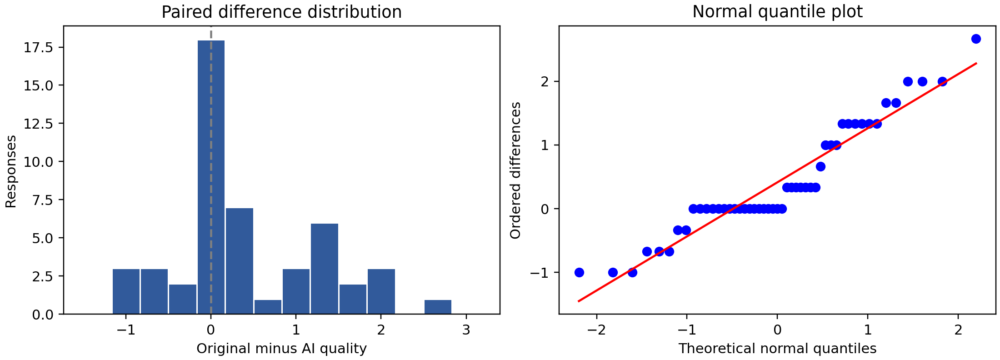
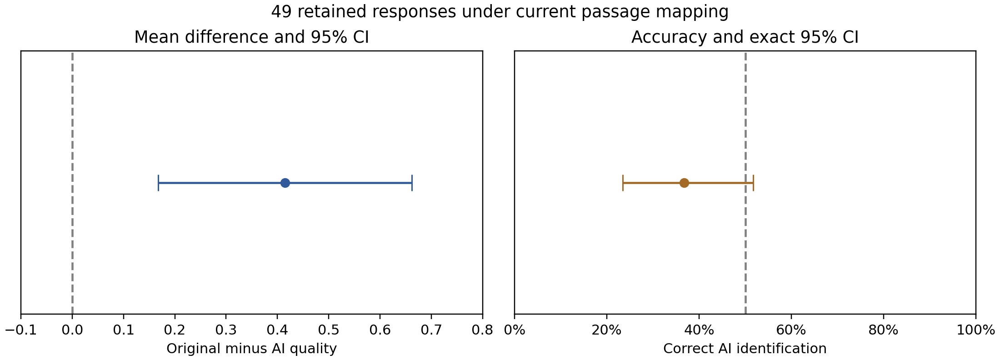

# Perceived writing quality and AI detection in a sleep and memory passage study

Debshree Chowdhury and Jakub Romańczuk

AIPI 510 Term 2 Project

Response snapshot analyzed November 2, 2026

## Abstract

We compared perceived writing quality and AI identification for an original NIH News in Health passage and an AI rewrite about sleep and memory. Participants read both versions, rated clarity, engagement, and overall writing on seven-point scales, answered comprehension checks, and identified the AI passage. The circulated form presented AI first and the original second. Of 54 submissions, five failed both comprehension checks, leaving 49 complete paired responses. Mean composite quality was 5.83 for the original and 5.41 for the AI rewrite. The original-minus-AI difference was 0.415 points, 95% confidence interval [0.167, 0.663], t(48) = 3.369, p = .00149, Cohen dz = 0.481. AI detection accuracy was 36.7% (18/49), with an exact 95% confidence interval of [23.4%, 51.7%]; the exact binomial test did not reject chance performance, p = .0854. Quality findings were stable in legacy-response and nonparametric sensitivity analyses, whereas detection depended on one response's uncertain version. Fixed order, one passage pair, convenience sampling, and questionnaire changes during collection limit generalization. The results support a quality-rating difference for this pair, while leaving detection performance uncertain.

## Background and motivation

Readers encounter AI-assisted prose in educational and scientific communication. Two questions arise: whether a rewrite changes perceived quality and whether readers can recognize its origin. These outcomes need separate measurement. A passage can be judged clear or engaging while its authorship is misclassified; neither judgment alone establishes factual accuracy or learning.

Prior work provides reasons to avoid assuming reliable human detection. Jakesch, Hancock, and Naaman (2023) found that judgments of AI-generated self-presentations relied on imperfect linguistic heuristics. Gao et al. (2023) examined scientific abstracts using blinded reviewers and found both missed generated texts and false accusations against original texts. Their tasks and materials differ from this study, so their detection rates are not directly comparable with a forced choice between two closely related passages.

We used an excerpt from NIH News in Health's April 2013 article Sleep On It and an AI rewrite of the same content (National Institutes of Health, 2013). Keeping the topic and principal information similar supports a focused comparison of prose. This study evaluates perceived writing and source identification; it does not test the underlying sleep science or memory performance.

## Null and alternative hypotheses

The quality null hypothesis is that the population mean within-person difference between original and AI composite scores equals zero. The alternative is a nonzero difference. The detection null is that the probability of correctly identifying the AI passage equals .50; the alternative is a probability different from .50. Both tests are two-sided.

We report the originally proposed nominal significance level of .05, together with a conservative two-test Bonferroni sensitivity threshold of .025 for the two primary questions. This multiplicity assessment was added during analysis, rather than preregistered. The quality finding meets both thresholds; the primary detection result meets neither. Confidence intervals are marginal 95% intervals, not simultaneous familywise intervals.

## Description of experimental design

This was a within-person paired comparison. The independent variable was passage version: original or AI rewrite. The original was the comparison condition. Dependent variables were clarity, engagement, and overall writing ratings, each from 1 (Not at all) to 7 (Extremely); their mean formed the quality composite. Detection correctness was coded 1 or 0, and confidence ranged from 1 to 5. Participant status and student background described the sample. Optional names were collected separately from the analytic variables.

The form introduced two short science-news passages without announcing AI authorship. Each passage page contained the three ratings and the same comprehension question about the approximately 90-minute sleep cycle. A later page disclosed that one text had been rewritten and requested a forced choice, confidence, and an optional explanation. The answer key, source, rationale for initial nondisclosure, and study contacts appeared after submission. Response editing was disabled.

The circulated form presented AI as Passage 1 and the original as Passage 2. No evidence supports randomized order or balanced allocation in these responses. Consequently, version and position are confounded. Both passages used the same plain-text presentation without separate source branding, but textual NIH references and the shared scientific quotation remained. The rewrite's model, model version, and complete original generation prompt were not preserved in the analyzed export, limiting stimulus reproducibility.

Participation was voluntary through a shared online link, yielding a convenience sample. Eligibility changed from graduate students to students, working professionals, and others aged at least 18. The adult restriction was an instruction; the export contains no recorded age verification. One retained record still has the older affirmative status answer. The report evaluates the downloaded snapshot rather than asserting that collection had closed.

## Power analysis

Power calculations were prepared after collection began. They are planning sensitivities under assumed effects, not prospective justification, observed power, or evidence of preregistration. The initial n = 30 scenario refers to complete pairs. We used Python 3.10 and SciPy 1.15.3. The paired-t calculation uses the noncentral t distribution: the noncentrality is the assumed standardized paired difference multiplied by the square root of the number of complete pairs, with n minus one degrees of freedom. Cohen dz uses the standard deviation of within-person differences, not the pooled standard deviation of the two passages.

| Assumed absolute dz | Pairs for 80% power at .05 | Power with 30 pairs at .05 | Pairs for 80% power at .025 |
|---|---:|---:|---:|
| 0.30 | 90 | 35.5% | 109 |
| 0.50 | 34 | 75.4% | 41 |
| 0.80 | 15 | 98.8% | 18 |

For detection, we enumerated the symmetric rejection tails of an exact two-sided binomial test against .50. At a true accuracy of .70, the first sample size attaining 80% power is 49 at alpha .05 and 58 at alpha .025. With 30 respondents, corresponding powers are 58.9% and 43.2%. For true accuracies .60 and .80, the first qualifying sample sizes at .05 are 199 and 20. Exact-test power changes discretely, so a first qualifying n is not a guarantee that every larger n attains that power. These scenarios assume independent, identically distributed responses and do not address recruitment bias or fixed-order confounding.

No attrition allowance was specified prospectively. For illustration, 34 usable pairs with a 10% allowance would require 38 recruits, calculated by dividing 34 by .90 and rounding up. This is a planning example, not a claim about the actual recruitment target. The report does not compute power from the observed effect.

## Data collection and cleaning procedures

The CSV contained 54 submissions dated October 31 to November 2, 2026 in the export's timestamp labels. All 54 affirmed consent. Status was Working professional for 36, Student for 15, Other for two, and the legacy Yes for one. Student-background responses were international for 11, domestic for eight, and not applicable for 35. The mismatch between 19 student-background responses and 15 Student classifications may reflect overlapping work/study roles or interpretation differences; it was not an automatic exclusion. Thirty-five names and 21 optional explanations were supplied.

We preserved the downloaded CSV unchanged in local restricted storage and recorded its SHA-256 checksum in the aggregate results. No names or participant explanations are included in the repository outputs. Because both passage blocks use identical question labels, the report script checks the entire export header sequence and maps passage-position columns explicitly. This avoids confusing repeated column names. Ratings, comprehension responses, confidence, consent, and detection were complete. No missing values were imputed.

The proposed exclusion rule removes a respondent only if both comprehension checks are wrong. Six missed the first check and six missed the second; five missed both. Five were excluded, leaving 49 for both primary analyses. Forty-seven passed both checks and two passed one. No timing exclusion was applied because Google Forms did not collect passage-page times. No verified pilot or duplicate-person labels were available, so no such records were removed. Three repeated answer patterns were observed in the full sample; matching ratings do not establish repeated participation.

The primary mapping assumes the current AI-first version for all retained responses. The legacy record's version cannot be verified from the CSV alone. We therefore report analyses omitting it and reversing its version mapping, rather than selecting a treatment based on statistical significance. Names were dropped from analysis, and any request to identify a submitted response would require a separately protected record. Questionnaire revisions and the lack of a verified prospective registration are documented as limitations.

## Statistical analysis

For each participant and version, quality was the arithmetic mean of all three ratings. We calculated the original-minus-AI paired difference, its standard deviation, a two-sided paired t-test, a t-based 95% confidence interval, and Cohen dz. Reliability was summarized using Cronbach alpha separately for the two three-item scales on the 49 retained pairs. A two-level paired comparison needs no post hoc pairwise test.

We examined the distribution of paired differences with a histogram, a quantile plot, and Shapiro-Wilk. Independence depends on recruitment and duplicate review and cannot be established by this test. Differences deviated from normality, W = .917, p = .00208. The bounded scales and 18 tied composites warranted an exploratory Wilcoxon signed-rank sensitivity analysis. Mathematical ties were preserved by rounding differences to ten decimal places; its p-value uses a normal approximation with zeros omitted. This test has different assumptions and does not directly test the identical population-mean hypothesis.

Detection was evaluated against 50/50 using the proposed chi-square goodness-of-fit test and an exact two-sided binomial test. Expected chi-square counts were 24.5 per category. We report an exact 95% confidence interval for accuracy and Cohen w for the chi-square effect. We also describe confidence and its exploratory rank association with correctness. AI-use and English proficiency were absent from the export, so the proposed regression was not estimable. No three-category status comparison was forced into a 2-by-2 Fisher test.

Figure 1. Diagnostic views of the 49 original-minus-AI composite differences. Ties and bounded responses produce departures from the normal reference pattern.

### Quality results

| Outcome | AI mean | Original mean | Original minus AI |
|---|---:|---:|---:|
| Clarity | 5.755 | 6.082 | 0.327 |
| Engagement | 5.163 | 5.653 | 0.490 |
| Overall writing | 5.327 | 5.755 | 0.429 |
| Composite quality | 5.415 | 5.830 | 0.415 |

Composite standard deviations were 1.127 for AI and 0.869 for the original. The standard deviation of paired differences was 0.862. The paired test gave t(48) = 3.369, p = .00149, with 95% confidence interval [0.167, 0.663] for the original advantage and dz = 0.481. Original quality was higher for 23 participants, AI quality was higher for eight, and 18 tied. Alpha was .865 for AI and .875 for the original. These estimates indicate internal consistency in this sample, not proof of construct validity.

The exploratory Wilcoxon sensitivity yielded W = 94.0, p = .00242. Omitting the legacy record gave a mean original advantage of 0.424, 95% confidence interval [0.171, 0.676], t(47) = 3.377, p = .00148, and dz = 0.487. Reversing that record's version labels did not change the composite comparison because its two composite scores were equal. Thus, the rating direction and inference are stable under the examined version sensitivities.

### Detection results

Eighteen of 49 respondents correctly selected Passage 1 under the current mapping, while 31 selected Passage 2. Accuracy was 36.7%, exact 95% confidence interval [23.4%, 51.7%]. The exact binomial p-value was .0854. The chi-square test gave chi-square(1) = 3.449, p = .0633, with Cohen w = 0.265. Neither test rejected the chance null at .05.

| Version sensitivity | n | Correct | Exact detection p | Chi-square p |
|---|---:|---:|---:|---:|
| Current mapping | 49 | 18 | .0854 | .0633 |
| Omit legacy response | 48 | 17 | .0595 | .0433 |
| Legacy response original first | 49 | 17 | .0444 | .0321 |

Detection is sensitive to the legacy record and test choice. None of these detection p-values meets .025. The unfiltered exact p-value of .0402 from 54 submissions is not the result after the planned comprehension exclusion. It would be misleading to report that unfiltered finding as the cleaned analysis.

Mean confidence was 3.16 out of 5: 3.06 among correct respondents and 3.23 among incorrect respondents. The exploratory Spearman association was weak, rho = -.088, p = .546. Optional explanations mentioned flow, structure, conversational tone, sentence complexity, and guessing. We did not formally code those comments or treat them as validated authorship cues.

Figure 2. Composite difference and detection accuracy for 49 retained responses. Intervals are marginal 95% confidence intervals. The left reference line is no mean difference; the right is 50% chance. Labels use the current AI-first mapping.

## Interpretation of results

The original passage received higher quality ratings in this sample, with a mean advantage of approximately four-tenths of a scale point and a standardized paired difference of 0.48. Engagement showed the largest descriptive component gap. Both passages still received relatively high ratings. Statistical significance does not establish that every reader preferred the original, nor that this magnitude would be important in every application.

Respondents more frequently identified the original as AI-written under the current mapping. After cleaning, uncertainty included chance, and legacy-version sensitivities changed nominal detection significance. The appropriate conclusion is uncertain detection performance for this pair, rather than equivalence to chance or universal inability to detect AI. Quality ratings and detection should remain distinct: assigning AI authorship to a passage does not establish either higher or lower objective quality.

The original's apparent advantage could partly reflect position or familiarity because everyone encountered substantially the same information twice in a fixed order. We therefore interpret the paired result as a difference between these presented passage conditions, rather than an isolated causal effect of authorship.

## Limitations

First, fixed AI-first order confounds passage version with presentation position and permits carryover. Second, one topic and one rewrite cannot represent human or AI writing generally; the stimuli also share a direct scientific quotation. Third, convenience recruitment and the predominance of working professionals limit population inference. Fourth, the eligibility and name questions changed during launch, and one record lacks a verified passage version. Fifth, age, time on passage pages, AI-use, and English proficiency were not recorded in the export. Sixth, duplicate-person, pilot, and test-response status could not be verified; identical rating patterns were retained. Seventh, optional names made some responses identifiable, and early anonymous and later identified responses followed different notices. Finally, analysis amendments, multiplicity handling, and power sensitivities were retrospective. Instructor or ethics approval is not established by the available records and is not claimed here.

## Conclusion and recommendations

In this response snapshot, the original sleep-and-memory passage received higher composite quality ratings than its AI rewrite, and this difference persisted across the examined sensitivities. Cleaned detection accuracy was below .50 numerically but did not provide stable evidence of a difference from chance. These findings concern this fixed-order passage pair and sampled respondents.

A follow-up should randomize passage order, use multiple independently selected passage pairs, preserve model and prompt provenance, and freeze eligibility, exclusions, and the testing policy before recruitment. If reading-time exclusions or order blocking are essential, use a platform that records those features. Keep names separate from analytical data when participation tracking is needed. Verify the legacy response and any known pilot records before the team signs off on the final dataset, and report any resulting changes transparently.

## References

Gao, C. A., Howard, F. M., Markov, N. S., Dyer, E. C., Ramesh, S., Luo, Y., & Pearson, A. T. (2023). Comparing scientific abstracts generated by ChatGPT to real abstracts with detectors and blinded human reviewers. npj Digital Medicine, 6, 75. https://doi.org/10.1038/s41746-023-00819-6

Jakesch, M., Hancock, J. T., & Naaman, M. (2023). Human heuristics for AI-generated language are flawed. Proceedings of the National Academy of Sciences, 120(11), e2208839120. https://doi.org/10.1073/pnas.2208839120

National Institutes of Health. (2013, April). Sleep On It. NIH News in Health. https://newsinhealth.nih.gov/2013/04/sleep-it

SciPy developers. (n.d.). Statistical functions and distribution documentation for ttest_rel, binomtest, chisquare, shapiro, wilcoxon, nct, and binom. https://docs.scipy.org/doc/scipy/reference/stats.html

## Reproducibility and contribution note

Statistical calculations use Python 3.10, NumPy 2.2.6, and SciPy 1.15.3. The repository includes executable report-evidence and power scripts, aggregate JSON outputs, the expected export headers, and reproduction instructions. Identifiable CSV exports are withheld from GitHub. The report records a November 2 snapshot and does not imply live collection was stopped. AI assistance was used to prepare code and report text; the project members are responsible for reviewing the analysis, references, and final submission.
