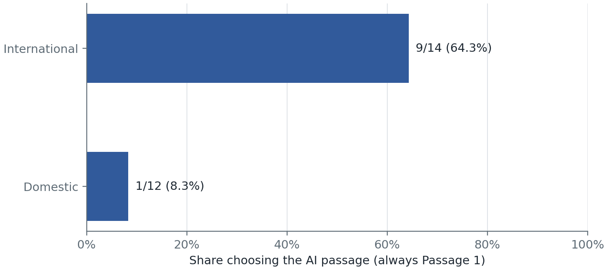
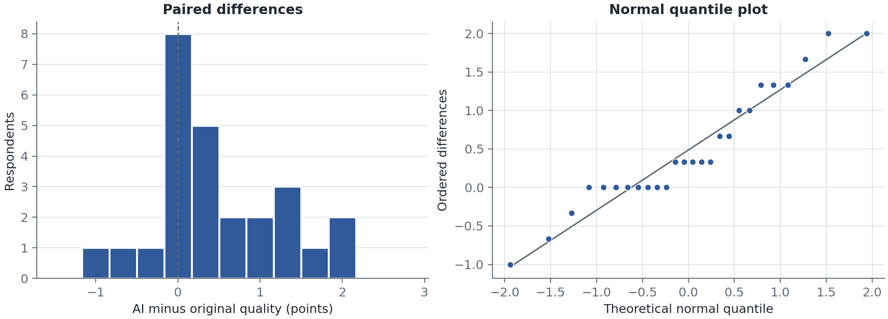
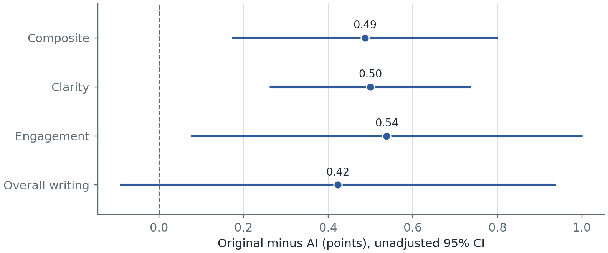
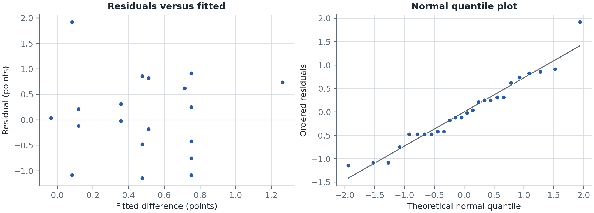
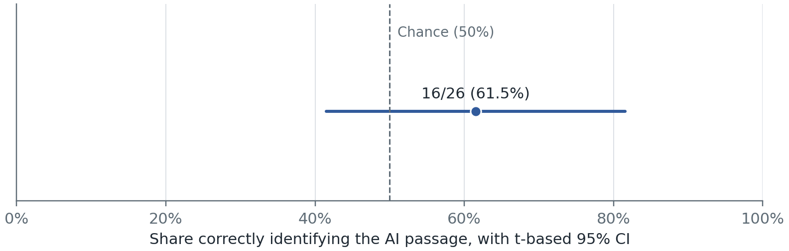

# Do international and domestic students differ in identifying an AI rewrite? A sleep and memory passage study

Debshree Chowdhury and Jakub Romańczuk

AIPI 510 Term 2 Project

Responses downloaded November 2, 2026

## Abstract

Our main question was whether international and domestic students differ in identifying an AI rewrite of a science passage. Participants read an original NIH News in Health passage about sleep and memory and an AI rewrite, rated each for clarity, engagement, and overall writing on seven-point scales, answered comprehension checks, and identified the AI passage. The circulated form presented AI first and the original second. Of 64 submissions, we analyzed the 26 students who answered both checks correctly: 14 international and 12 domestic. The three planned tests used a Bonferroni threshold of .05/3 = .0167. International students identified the AI passage more often than domestic students, 9/14 (64.3%) versus 1/12 (8.3%), a difference of 56.0 percentage points, 95% confidence interval [23.4, 88.5], Fisher's exact p = .0053. The written plan labelled this comparison exploratory, and it does not reach the threshold without the last ten responses (p = .145). Because the AI passage was always first, a correct answer always meant choosing Passage 1, so the difference cannot be separated from a preference for the first passage. Students also rated the original higher, by 0.487 points, 95% confidence interval [0.175, 0.799], t(25) = 3.213, p = .0036, dz = 0.630; this also cannot be separated from position. Overall detection accuracy, 10/26 (38.5%), did not differ reliably from chance, chi-square(1) = 1.385, p = .239. These results justify a randomized follow-up and do not establish that either group detects AI better.

## Background and motivation

Science writing produced with AI may be judged both for how well it reads and for who readers think wrote it. Those judgments need not agree: a passage can seem clear and engaging even when its source is misidentified. Our main question is whether respondents reporting international and domestic student backgrounds differ in which passage they identify as the AI rewrite. We also examine perceived writing quality and overall identification against chance. Student background is an observed grouping variable, not a measure of English proficiency or prior AI experience.

Human source judgments can rely on unreliable cues. Jakesch, Hancock, and Naaman (2023) studied judgments of AI-generated self-presentations, while Gao et al. (2023) studied scientific abstracts evaluated by blinded reviewers. Their findings motivate testing identification rather than assuming it is accurate. Their materials and tasks differ from our paired-passage task, so their detection rates are not benchmarks for this sample.

Our stimuli are an excerpt from NIH News in Health's April 2013 article Sleep On It and an AI rewrite of the same content (National Institutes of Health, 2013). Sharing a topic and factual content makes the prose comparison more focused, although a single pair cannot represent all original and AI writing. We make no directional prediction about which student-background group will choose the AI passage more often. This experiment measures writing judgments and source choices; it does not measure sleep, memory improvement, or objective learning.

## Null and alternative hypotheses

### H1: Detection by student background (main question)

H0: the probability of choosing the AI passage is equal for respondents reporting international and domestic student backgrounds. The alternative is that these probabilities differ. We use a two-sided Fisher's exact test. Respondents answering Not applicable do not enter this comparison. The labels describe reported student background, not independently verified citizenship, language proficiency, or current employment status.

The October 30 analysis plan listed Fisher's exact test for student status by detection correctness as exploratory, and the instrument asked about international/domestic background. It listed quality and overall detection as primary. We now lead with the group comparison because it is the team's main research interest. This emphasis and the current numbering were adopted on November 2 after earlier results had been examined. The existing record supports a planned exploratory comparison; it does not support presenting the later emphasis or stricter exclusion rule as prospectively confirmatory. The study was not preregistered.

### H2: Perceived quality (secondary)

H0: among current students, the population mean original-minus-AI composite quality difference equals zero. Alternative: the difference is nonzero. The test is two-sided, using the .05/3 = .0167 threshold shared by the three planned tests.

### H3: Overall detection against chance (secondary)

H0: the probability of correctly identifying the AI passage is .50 among the analyzed student-background respondents. The alternative is a probability different from .50. The question is two-sided: we did not choose an above-chance or below-chance direction from the observed result. H2 separately concerns the within-person quality difference.

### Testing policy

The three declared hypothesis tests use a Bonferroni threshold of .05/3 = .0167. This policy was adopted on November 2 and replaces the earlier nominal .05 tests and .025 sensitivity threshold. Applying it consistently to the three tests does not make the later emphasis, sample restriction, or stricter comprehension rule prospective. We therefore distinguish statistical rejection under the current analysis from confirmation in a preregistered study. Item-level analyses, regression, confidence and subgroup/sensitivity analyses remain exploratory. The 95% intervals are marginal and are not simultaneous intervals for this three-test family; their relation to zero is not a substitute for the .0167 decision threshold.

## Description of experimental design

The main analysis compares detection choices between respondents reporting international and domestic student backgrounds. Background was observed rather than assigned, and the binary outcome was whether the respondent selected the passage coded as AI. The secondary quality comparison is within-person: each respondent rated both versions for clarity, engagement and overall writing on scales from 1 (Not at all) to 7 (Extremely). The mean of these three ratings is the quality composite. Confidence in the source choice was recorded from 1 to 5. Names were optional and excluded from analytical data.

The form first introduced a short science-reading task without announcing AI authorship. Each passage was followed by the same three ratings and a comprehension question about the approximately 90-minute sleep cycle. After both passages, respondents were told that one was an AI rewrite and made a forced choice with a confidence rating and optional explanation. The source, answer key, reason for initial nondisclosure and study contacts appeared after submission. Response editing was disabled. The team reports that the instructor accepted the initial nondisclosure; this is not a claim of a separate ethics-board review.

The plan proposed randomized passage order, but the circulated version placed the AI rewrite first and the NIH original second. The analysis applies that AI-first mapping to all retained records, so a correct answer in the analyzed coding always means choosing Passage 1. There is no verified counterbalancing. A group difference can therefore reflect different tendencies to select the first passage as AI rather than different ability to recognize AI writing. Version and position are also confounded in the quality comparison. One legacy record's actual passage order remains uncertain and is examined through omission and reversal sensitivities.

Both passages used plain text without separate source headings or NIH branding, while NIH references and the shared quotation remained within the text. The generation record supplied by the team identifies GPT-6.1 SOL and two successive prompts, with the second output selected, rather than the first output envisaged in the initial protocol. The prompts and stimulus records are archived separately from the response export in study/stimuli/; provenance.md records verification against the current form on November 2 and remaining uncertainty, including the unknown generation date and historical form versions. The live original retained an unmatched closing quote at its end; original.txt preserves it, while the instrument reference was corrected separately. Having the prompt does not guarantee that the same model output can be regenerated.

Recruitment used a voluntary shared link and produced a convenience sample. The status question broadened during launch to Student / Working professional / Other, but the current introductory text still asks for adult graduate students. These instructions and categories are not fully aligned. The adult requirement was an instruction, not a recorded age check. For the current analysis, student background defines eligibility, so the analyzed group is not identical to respondents who selected Student as current status. The November 2 workbook contains responses through 19:03 in its timestamp labels; the team reports that collection is now closed.

Each person contributed one source choice and one confidence answer. Detection is therefore a between-person group comparison, while quality uses paired ratings. Neither background nor passage order was randomized in the collected sample. Associations should not be interpreted as causal effects of background.

## Power analysis

### H1: Between-group detection planning

These calculations were prepared after collection began. They describe power at assumed underlying accuracies, not observed power or a prospective sample-size justification. The committed implementation uses NumPy and SciPy and enumerates independent binomial outcomes for two groups. For each outcome table it applies the two-sided Fisher rejection rule, then sums alternative probabilities over the rejected tables. The current group sizes are 14 and 12. Both the nominal .05 level and the study's .05/3 threshold are shown for comparison; the latter determines the current testing decisions.

| Assumed accuracies | Power at 14 vs 12, .05 | Power at 14 vs 12, .0167 |
|---|---:|---:|
| .50 vs .70 | 12.1% | 6.0% |
| .30 vs .60 | 27.3% | 15.3% |
| .50 vs .80 | 27.3% | 15.6% |
| .10 vs .60 | 75.4% | 59.4% |

Even the assumed .10 versus .60 scenario falls short of the .80 power target at the corrected threshold. Moderate underlying gaps would often be missed with groups this small. A statistically significant result in a small study can also overestimate the magnitude of the underlying difference; the observed gap should not be used alone to plan a replication.

The table comes from results/quality/hypothesis_tests.json, H1_power_assumed_rates. A future study should choose a practically relevant group difference before recruitment, calculate the sample size at the intended familywise threshold, allow for exclusions, and balance recruitment where possible. The current table does not establish that a particular larger recruitment target is sufficient. More participants would improve precision but would not repair fixed-order confounding or convenience sampling.

### H2: Paired quality planning

Power calculations were prepared after collection began. They are planning sensitivities under assumed effects, not prospective justification, observed power, or evidence of preregistration. The initial n = 30 scenario refers to complete pairs. We used Python 3.10 and SciPy 1.15.3. The paired-t calculation uses the noncentral t distribution: the noncentrality is the assumed standardized paired difference multiplied by the square root of the number of complete pairs, with n minus one degrees of freedom. Cohen dz uses the standard deviation of within-person differences, not the pooled standard deviation of the two passages.

| Assumed absolute dz | Pairs for 80% power at .05 | Power with 30 pairs at .05 | Pairs for 80% power at .0167 |
|---|---:|---:|---:|
| 0.30 | 90 | 35.5% | 120 |
| 0.50 | 34 | 75.4% | 45 |
| 0.80 | 15 | 98.8% | 20 |

No attrition allowance was specified prospectively. For illustration, 34 usable pairs with a 10% allowance would require 38 recruits, calculated by dividing 34 by .90 and rounding up. This is a planning example, not a claim about the actual recruitment target. The report does not compute power from the observed effect.

### H2: Sensitivity at the achieved sample

The analyzed sample has 26 complete pairs, below both the initial n = 30 scenario and the 34 pairs needed for 80% power at an assumed dz of 0.50. With 26 pairs and 80% power, the smallest detectable standardized paired difference is about dz = 0.57 at .05 and dz = 0.67 at the .0167 threshold. Power at .05 and .0167 is 31.3% and 17.1% for an assumed dz of 0.30, 68.8% and 50.4% for 0.50, and 97.5% and 92.6% for 0.80. These values use assumed effects at the achieved sample size, not the observed effect, so they describe what the design could detect and not the strength of the observed result. They were calculated with the same SciPy version under Python 3.13. The study is therefore poorly placed to detect small differences, and a nonsignificant follow-up in this sample does not show that a difference is absent.

### H3: Overall detection planning

Power is the binomial probability of a correct-response count falling in the rejection region of the specified chi-square goodness-of-fit test against .50. Participant choices are assumed independent with a common underlying accuracy. These are retrospective calculations under assumed rates, not power calculated from the observed accuracy. The target is .80 power, with complete analyzed responses determining n.

| Assumed true accuracy | First n with 80% power at .05 | Power at n = 26, .05 | Power at n = 26, .0167 | First n with 80% power at .0167 |
|---|---:|---:|---:|---:|
| .60 | 187 | 22.8% | 5.6% | 257 |
| .70 | 43 | 62.7% | 29.7% | 61 |
| .80 | 19 | 94.1% | 74.7% | 24 |

At the corrected threshold, the current sample does not reach .80 power even in the assumed .80-accuracy scenario. Thus, failure to reject H3 does not establish chance-level performance. Rejection regions change discretely, so the first qualifying n is not a guarantee that every larger n attains the target. The assumed-rate results are recorded in results/quality/hypothesis_tests.json, H3_power_assumed_rates. The assumptions do not address possible first-passage response tendencies or uncertainty about participant independence.

## Data collection and cleaning procedures

The analyzed Google Forms workbook contained 64 submissions dated October 31 to November 2, 2026 in the export's timestamp labels. All 64 affirmed consent. Status was Working professional for 36, Student for 25, Other for two, and the legacy Yes for one. Student background was international for 15, domestic for 14, and not applicable for 35. Thirty-six names and 21 optional explanations were supplied. Ten of the 64 arrived after the earlier 54-response snapshot, within about 15 minutes on November 2; all ten were students, and the team reports that they came from different people and not a single class or group.

We preserved the downloaded workbook unchanged in local restricted storage and recorded its SHA-256 checksum in the aggregate results. A script converts it to a private CSV, and the importer then keeps only reviewed columns by position, because both passage blocks use the same question labels. Names, timestamps, and participant explanations are discarded at that step and appear in no repository output. Ratings, comprehension responses, confidence, consent, and detection were complete. No missing values were imputed.

We applied two exclusion rules. First, we kept only respondents who reported being an international or domestic student, because the main comparison is between those groups and the study was originally designed for graduate students; the 35 who answered "Not applicable — not currently a student" were removed. Second, we required the correct answer, 90 minutes, on both comprehension checks, treating any wrong answer as evidence that the passage may not have been read carefully. Of the 29 student-background respondents, two missed both checks and one missed one, leaving 26 for analysis: 14 international and 12 domestic. By stated status, these were 23 Student, two Working professional, and the one legacy Yes. Status and student background did not align exactly, and we used the student-background answer for the rule.

| Step | Removed | Remaining |
|---|---:|---:|
| Submissions | | 64 |
| Not currently a student | 35 | 29 |
| Both comprehension checks wrong | 2 | 27 |
| One comprehension check wrong | 1 | 26 |

The student restriction follows from the planned international versus domestic comparison, which was written down before collection began. The stricter check rule is retrospective: it was adopted on November 2, after the 54-response results had been seen, and it replaces the planned rule that removed a respondent only if both checks were wrong. We therefore also report the planned check rule as a sensitivity analysis. Across all 64 submissions, six missed the first check, six missed the second, and five missed both, so the planned check rule retains 59 of the 64 submissions and 27 of the 29 students.

No timing exclusion was applied because Google Forms did not collect passage-page times. The team reports that no pilot responses were collected. No verified duplicate-person labels were available, so no such records were removed. Four answer patterns repeated across the 64 submissions, two of them among the 26 retained; matching answers do not establish repeated participation.

The primary mapping assumes the current AI-first version for all retained responses. The legacy record's version cannot be verified from the export alone, so we report analyses omitting it and reversing its version mapping, rather than selecting a treatment based on statistical significance. Any request to identify a submitted response would require a separately protected record. Questionnaire revisions and the lack of a verified prospective registration are documented as limitations.

## Statistical analysis

### H1: Student-background comparison

We compare the background answers as reported, rather than substituting the separate current-status field. Each respondent contributes one binary source choice. Under the current coding, a correct answer is Passage 1. The groups do not overlap, but independence between respondents is an assumption of the test, not a fact established by the export. The expected domestic-correct count under independence is 4.62, so the chi-square approximation is questionable; we use the specified two-sided Fisher's exact test for the sparse table. The descriptive effect is the international-minus-domestic difference in proportions. Its 95% interval uses a Welch t calculation on the 0/1 outcomes; it is approximate, is not an exact Fisher interval, and is not adjusted for multiplicity.

| Background | Correct | Incorrect | Accuracy |
|---|---:|---:|---:|
| International | 9 | 5 | 64.3% |
| Domestic | 1 | 11 | 8.3% |

The observed choices were 9/14 versus 1/12. The difference was 56.0 percentage points, 95% confidence interval [23.4, 88.5], Fisher's exact p = .0053. This p-value is below .0167, so H0 is rejected under the current specification. It is evidence of a difference in choices for this sample and coding, not proof that student background causes better AI recognition. The retrospective analysis decisions remain relevant despite the corrected p-value.

Figure 1. Proportion of each group selecting the passage coded as AI. Under the fixed AI-first mapping, this is also the proportion selecting Passage 1.

| Sensitivity | International | Domestic | Fisher p |
|---|---:|---:|---:|
| Planned both-wrong check rule | 10/15 | 1/12 | .0047 |
| Omitting the legacy record | 8/13 | 1/12 | .0112 |
| Reversing the legacy record | 8/14 | 1/12 | .0145 |
| Stated status Student only | 7/12 | 1/11 | .0272 |
| Without the last ten responses | 6/10 | 1/6 | .145 |
| Planned check rule, 54-response snapshot | 7/11 | 1/6 | .1312 |

The direction is the same across these subsets and mappings. The first three sensitivity p-values are below .0167, while the stated-Student-only and earlier-response subsets are not. These analyses change the sample or coding; comparing their p-values is not a formal test that the underlying effects differ. The final historical row uses the archived 54-response results, rather than the current workbook.

The last ten analyzed responses arrived within approximately 15 minutes; their counts were 3/4 correct for international-background and 0/6 for domestic-background respondents. The team reports that these were different people, not a single class or group. Timing alone is not evidence that participants discussed answers or that responses were dependent. Removing them is a sensitivity analysis, not evidence that they are invalid observations. Primary and current-workbook sensitivity values come from results/quality/hypothesis_tests.json; the historical snapshot is retained in results/snapshot_group_statistics.json.

### H2: Quality analysis

For each participant and version, quality was the arithmetic mean of all three ratings. We calculated the original-minus-AI paired difference, its standard deviation, a two-sided paired t-test, a t-based 95% confidence interval, and Cohen dz. A paired t-test fits because each participant rated both versions, so the differences within people are the unit of analysis. We summarized how closely the three ratings agreed using descriptive pairwise correlations within each version. A two-level paired comparison needs no post hoc test between versions; item-level follow-ups are reported below.

We examined the distribution of paired differences with a histogram, a quantile plot, and Shapiro-Wilk. Independence depends on recruitment and duplicate review and cannot be established by this test. Shapiro-Wilk did not reject normality, W = .938, p = .119, although with 26 pairs it has limited power, and the bounded scales and eight tied differences warranted a Wilcoxon signed-rank sensitivity analysis. Mathematical ties were preserved by rounding differences to ten decimal places; its p-value uses a normal approximation with zeros omitted. This test has different assumptions and does not directly test the identical population-mean hypothesis.

Figure 2a. Diagnostic views of the 26 original-minus-AI composite differences. Eight respondents rated the two versions equally.

### Quality results

| Outcome | AI mean | Original mean | Original minus AI |
|---|---:|---:|---:|
| Clarity | 5.923 | 6.423 | 0.500 |
| Engagement | 5.154 | 5.692 | 0.538 |
| Overall writing | 5.346 | 5.769 | 0.423 |
| Composite quality | 5.474 | 5.962 | 0.487 |

Composite standard deviations were 0.828 for AI and 0.568 for the original. The standard deviation of paired differences was 0.773. The paired test gave t(25) = 3.213, p = .0036, with 95% confidence interval [0.175, 0.799] for the original advantage and dz = 0.630. The p-value is below the Bonferroni threshold of .05/3 = .0167 for the three planned tests, so we reject H0. Original quality was higher for 15 participants, AI quality was higher for three, and eight tied. The Wilcoxon sensitivity agreed, W = 22.5, p = .00579.

| Correlation between | AI rewrite | Original |
|---|---:|---:|
| Clarity and engagement | .45 | .37 |
| Clarity and overall writing | .30 | .10 |
| Engagement and overall writing | .60 | .53 |

Engagement and overall writing moved together, while clarity was only weakly related to overall writing, especially for the original. The three ratings therefore do not behave as interchangeable measures, and the composite should be read alongside the items.

### Item-level post hoc tests

To see which ratings contributed to the composite difference, we compared each item with a paired t-test as a post hoc follow-up. Bonferroni correction for three tests sets the per-test threshold at .05/3 = .0167, which is equivalent to multiplying each p-value by three. Shapiro-Wilk rejected normality for all three item differences, which take few distinct values, so we also report Wilcoxon p-values.

| Item | Original minus AI | 95% CI | t(25) | p | Bonferroni p | dz | Wilcoxon p |
|---|---:|---:|---:|---:|---:|---:|---:|
| Clarity | 0.500 | [0.264, 0.736] | 4.372 | .00019 | .00057 | 0.857 | .00079 |
| Engagement | 0.538 | [0.078, 0.999] | 2.409 | .0237 | .0710 | 0.473 | .0253 |
| Overall writing | 0.423 | [-0.090, 0.936] | 1.698 | .102 | .306 | 0.333 | .133 |

Figure 2b. Original-minus-AI differences for the composite and each item, with unadjusted 95% confidence intervals.

Only clarity stayed below the corrected threshold. These tests follow up H2 and are not additional planned hypotheses. Because the same respondents rated all three correlated items, Bonferroni is conservative here.

### Quality by student background (exploratory)

We compared the paired quality difference between groups to check that the combined result was not hiding opposing patterns, as in Simpson's paradox. The original advantage was 0.405 for international students (n = 14; 95% CI [-0.125, 0.934]; p = .123) and 0.583 for domestic students (n = 12; 95% CI [0.210, 0.957]; p = .00557), so both groups point in the same direction. The groups did not differ reliably: Welch t(22.4) = 0.599, p = .555, with a 95% confidence interval for the international-minus-domestic difference of [-0.796, 0.439]. Levene's test did not indicate unequal variances, p = .477, and Mann-Whitney gave U = 103, p = .333. Subgroups this small cannot show that the groups respond alike.

### Exploratory regression

AI-use and English reading proficiency were absent from the export, so the originally proposed regression cannot be fitted. They must not be inferred from student background or replaced with invented covariates. We instead fit an exploratory multiple linear regression of the original-minus-AI difference on predictors that were collected: international background (1 = international, 0 = domestic), correct detection (1 = correct), and detection confidence (1 to 5).

| Term | Estimate | SE | t(22) | p | 95% CI |
|---|---:|---:|---:|---:|---:|
| Intercept | 1.929 | 0.795 | 2.427 | .0239 | [0.281, 3.576] |
| International | -0.238 | 0.366 | -0.650 | .522 | [-0.998, 0.522] |
| Correct detection | -0.036 | 0.395 | -0.090 | .929 | [-0.855, 0.783] |
| Confidence | -0.393 | 0.220 | -1.784 | .0883 | [-0.850, 0.064] |

The model did not explain significant variation, F(3, 22) = 1.262, p = .312, R-squared = .147, adjusted R-squared = .031. Residual plots showed no clear pattern, Shapiro-Wilk on the residuals did not reject normality, W = .959, p = .376, and Breusch-Pagan did not indicate unequal residual variance, LM = 4.874, p = .181. With 26 respondents and three predictors the estimates are imprecise, so these nonsignificant coefficients do not show that the predictors are unrelated to the difference.

Figure 2c. Residual diagnostics for the exploratory regression.

### Sensitivity analyses

| Analysis | n | Original minus AI | 95% CI | t | p | dz |
|---|---:|---:|---:|---:|---:|---:|
| Primary: students, both checks correct | 26 | 0.487 | [0.175, 0.799] | 3.213 | .0036 | 0.630 |
| Omitting the legacy record | 25 | 0.507 | [0.184, 0.830] | 3.238 | .00351 | 0.648 |
| Planned check rule, all 64 submissions | 59 | 0.390 | [0.178, 0.602] | 3.676 | .00052 | 0.479 |
| Planned check rule, 54-response snapshot | 49 | 0.415 | [0.167, 0.663] | 3.369 | .00149 | 0.481 |

Reversing the legacy record's version labels did not change the composite comparison because its two composite scores were equal. The direction and significance of the composite difference are therefore stable across the exclusion rules and version sensitivities, while the estimate ranges from 0.390 to 0.507.

The item-level pattern was not stable. In the 49-response snapshot analysis, engagement and overall writing met the corrected threshold and clarity did not, the reverse of the primary result, so no individual item should be singled out. That analysis also gave W = 94.0, p = .00242 for the composite Wilcoxon sensitivity. We reproduced its 49 retained responses, composite difference and detection counts independently from the first 54 rows of the workbook.

### H3: Overall detection

For the same 26 student-background respondents, we compare correct and incorrect counts with the 50/50 null using chi-square goodness-of-fit. Both expected counts are 13. The test assumes independent choices and adequate expected counts. This is a single detection response per person, not a paired comparison of two detection scores. We report an approximate t-based 95% interval on the binary scores; it is marginal, not adjusted to match the three-test threshold. No post hoc pairwise test is required.

Ten of 26 respondents selected Passage 1, which the analysis codes as correct, while 16 selected Passage 2. Accuracy was 38.5%, 95% confidence interval [18.4%, 58.5%], or 11.5 percentage points below chance. The test gave chi-square(1) = 1.385, p = .239. At .0167, we do not reject H0. The interval and the limited sample do not support an equivalence claim.

Figure 3. Overall accuracy with an approximate t-based 95% interval. The dashed reference is chance; the interval includes it.

| Sensitivity | n | Correct | Chi-square p |
|---|---:|---:|---:|
| Omitting the legacy record | 25 | 9 | .162 |
| Reversing the legacy record | 26 | 9 | .117 |
| Planned check rule, students | 27 | 11 | .336 |
| Planned check rule, all respondents | 59 | 21 | .0269 |
| Planned check rule, 54-response snapshot | 49 | 18 | .0633 |

None of these p-values is below .0167. The all-respondent sensitivity includes non-students, so it answers a different population question and should not replace the student result. Mapping uncertainty for the legacy response is disclosed rather than resolved by choosing the most favorable p-value.

### Confidence (exploratory)

The confidence scale runs from 1 (Just guessing) to 5 (Extremely confident). Its labels are ordinal, not numerical probabilities. Mean confidence was 3.31 and the median was 3. Correct respondents (n = 10) averaged 3.00, compared with 3.50 among incorrect respondents (n = 16). The two-sided Mann-Whitney comparison gave U = 55.5, p = .141. With these sample sizes and tied responses, the implementation uses the tie-corrected asymptotic distribution and a continuity correction. The test concerns confidence distributions, not equality of the displayed means.

This analysis supplies no clear evidence that confidence separates correct from incorrect choices. It does not establish that confidence is unrelated to accuracy in the population, and it cannot assess probability calibration. Optional explanations were not systematically coded. Current results are from results/quality/hypothesis_tests.json; the earlier snapshot remains a historical sensitivity record, not the current headline analysis.

## Interpretation of results

### H1: Student-background findings

International-background respondents selected the passage coded as AI more often than domestic-background respondents in the current sample. The Fisher result meets the stated three-test threshold. Its defensible interpretation is a difference in source choices under this presentation, rather than a general difference in AI-detection ability.

The central ambiguity is that selecting AI and selecting Passage 1 are the same coded response. The groups could differ in a tendency to label the first passage as AI, in how they interpret the two passages, or in genuine recognition; the design cannot separate these explanations. Student background was observed rather than assigned and is not a measured language-proficiency score, so neither causation nor an English-reading explanation follows from the group gap.

The direction persists across the reported sensitivities, but statistical rejection does not persist in every subset. In particular, the strict current-status Student subset and the earlier-response subset do not meet the threshold. This does not demonstrate that the excluded responses were invalid or that late and early effects differ; their sample sizes and membership change. The team reports that the final responses came from different people, not a single class or group. Their timing does not prove collaboration or dependence, although statistical independence remains an assumption.

The earlier plan labelled the group comparison exploratory, and its promotion to the lead question and the stricter comprehension rule occurred after earlier results were available. The finding is therefore a promising association for a prospectively specified, counterbalanced replication. It should not be presented as a settled ranking of international and domestic students' abilities.

### H2: Quality findings

The original passage received higher quality ratings among the student respondents, with a mean advantage of about half a scale point and a standardized paired difference of 0.63. The result kept its direction and significance under the planned, broader exclusion rule, where the estimate was somewhat smaller. Both passages still received relatively high ratings. Statistical significance does not establish that every reader preferred the original: 15 of 26 rated it higher and eight rated the versions equally. Nor does it show that this magnitude would matter in every application.

We would not single out one rating as the source of the difference. Clarity alone survived correction here, but a different pair of items did so in the 49-response snapshot, which suggests that the item-level pattern depends on who is included. Clarity was also only weakly related to overall writing, so readers may treat being easy to understand and being well written as different qualities, although these data cannot establish why. The student-background comparison and the regression found no reliable differences, but their small samples leave wide intervals, so they do not show that those factors are irrelevant.

The result does not establish that human authorship caused the higher ratings. Every verified response saw the AI rewrite first and the original second, so version and position are confounded. Readers met the same information a second time when rating the original, and familiarity or contrast could have shifted those ratings regardless of who wrote the text. The supported claim is narrower: in this order, with this passage pair, student respondents rated the second passage (the original) higher.

### H3: Overall detection and confidence findings

More analyzed respondents selected the original passage as AI than selected the rewrite, but the overall test does not reject chance at the stated threshold. The interval includes .50, and the power scenarios show that moderate departures from chance would often be missed with this sample. The conclusion is uncertain identification performance for this passage pair. Neither universal inability to recognize AI nor equivalence to guessing has been established.

H1 and H3 ask different questions: the groups can differ in their source choices even when the combined sample does not show a clear departure from chance. Opposing group tendencies can be obscured by pooling. Neither result resolves the fixed-order ambiguity.

Confidence was descriptively higher among incorrect choices, but the exploratory distribution comparison is inconclusive. A five-category verbal scale cannot establish calibrated probabilities of being correct. We therefore keep perceived quality, source choice and confidence separate when interpreting the experiment.

## Limitations

### Ratings and data

The fixed order bears directly on H2 because the quality difference cannot be separated from the effect of rating a passage second. The stricter comprehension rule was adopted after earlier results had been seen, so it cannot be treated as a prospective decision, even though the composite result did not depend on it. Restricting the sample to students reduced it from 64 to 26, which lowers power, widens intervals and limits conclusions to the student respondents. The three ratings agreed only partly, especially clarity and overall writing, so the composite combines qualities that readers may judge differently. We kept it because H2 was defined on it, and the item-level results are reported alongside it.

The three bounded rating items are subjective, and the t-test treats seven-point ratings and their averages as interval measures. Scores near the top of the scale can compress differences between versions. The nonparametric sensitivity is relevant but does not test exactly the same mean hypothesis. The item-level tests, subgroup check and regression are retrospective and exploratory, and they share the position confound.

Duplicate-person status could not be verified, and repeated answer patterns were retained. The team reports that no pilot responses were collected. Age, passage-page timing, AI-use and English proficiency were not collected in the export, preventing the proposed timing exclusion and the proposed covariate regression. Optional names made some responses identifiable, and early anonymous and later identified records followed different notices.

### Stimulus, design and sampling

The dominant design limitation is fixed order. Under the analysis's AI-first mapping, a correct answer always means choosing Passage 1. The H1 gap cannot distinguish recognition from a group difference in selecting the first passage as AI. Quality is similarly confounded with position, familiarity and possible carryover because both texts cover the same information. One topic and one selected rewrite provide no basis for claims about all human or AI prose. The shared quotation and textual NIH references also limit how independently the versions differ.

The team has now supplied the model label and two prompts and identified the second output as the selected rewrite. This corrects the earlier statement that the prompt had not been preserved. The archive records the supplied prompts, the unknown generation date and verification of both passage texts against the current live editor on November 2. The original there ends with an unmatched closing quote, which could itself be a source cue; its effect cannot be separated from the text comparison. A reported model name and prompt sequence are useful provenance but do not guarantee exact regeneration. A documentation punctuation correction must not be mistaken for a retroactive change to what participants saw.

Recruitment used a voluntary shared link. The analyzed student-background groups are small, unbalanced, and not randomly sampled or assigned. The team reports that the closely timed final responses came from different people, not a single class or group; timestamps alone do not establish dependence or independence. The sensitivity omitting them is less conclusive; it is not evidence of coordination or grounds to discard records automatically. Generalization beyond this convenience sample is limited.

The status and optional-name questions changed during launch, while the current introduction still requests graduate students. This mismatch limits claims that eligibility was consistently understood. Student-background answers and current-status answers do not always agree, and the primary analysis uses the former. One legacy record lacks verified passage assignment; omission and reversal analyses show the consequences of that uncertainty. Background is not a substitute for verified nationality, citizenship, English proficiency or experience with AI tools.

The team reports that collection is closed and that no pilot responses were collected. The group comparison was exploratory in the earlier plan. Its later emphasis, the .05/3 policy and the stricter comprehension rule were adopted after earlier results had been seen. A multiplicity correction does not remove the resulting risk of analysis selection. The findings should be reported with this history and the planned-rule sensitivities. The team reports that the instructor accepted the initial nondisclosure. No separate ethics-board review is documented, and instructor acceptance should not be described as such a review.

## Conclusion and recommendations

International students in this sample identified the AI passage far more often than domestic students, 9/14 versus 1/12. Because the AI passage was always first, this may reflect a preference for the first passage, and the result weakens without the last ten responses, so we do not conclude that international students are better at detecting AI. Students rated the original higher than the rewrite, a result that held across the examined exclusion rules but is also confounded with position. Overall detection did not differ reliably from chance. These findings concern this fixed-order passage pair and sampled respondents.

The priority for a follow-up is to retest the group difference with randomized passage order, so that a correct answer no longer means choosing the same position. It should recruit enough students in each group, roughly 50 per group for a 30-point gap at .05, use multiple independently selected passage pairs, preserve model and prompt provenance, and freeze eligibility, exclusions, and the testing policy before recruitment. It should also measure English proficiency, so that background and reading proficiency can be distinguished. If reading-time exclusions or order blocking are essential, use a platform that records those features. Keep names separate from analytical data when participation tracking is needed. Record each respondent's passage order with the response, so that no record's version is left unverified as one was here.

## References

Gao, C. A., Howard, F. M., Markov, N. S., Dyer, E. C., Ramesh, S., Luo, Y., & Pearson, A. T. (2023). Comparing scientific abstracts generated by ChatGPT to real abstracts with detectors and blinded human reviewers. npj Digital Medicine, 6, 75. https://doi.org/10.1038/s41746-023-00819-6

Jakesch, M., Hancock, J. T., & Naaman, M. (2023). Human heuristics for AI-generated language are flawed. Proceedings of the National Academy of Sciences, 120(11), e2208839120. https://doi.org/10.1073/pnas.2208839120

National Institutes of Health. (2013, April). Sleep On It. NIH News in Health. https://newsinhealth.nih.gov/2013/04/sleep-it

SciPy developers. (n.d.). Statistical functions and distribution documentation for ttest_rel, ttest_ind, chisquare, shapiro, levene, wilcoxon, nct, binom, fisher_exact, and mannwhitneyu. https://docs.scipy.org/doc/scipy/reference/stats.html

SciPy developers. (n.d.). Fisher exact test. https://docs.scipy.org/doc/scipy/reference/generated/scipy.stats.fisher_exact.html

SciPy developers. (n.d.). Mann-Whitney U test. https://docs.scipy.org/doc/scipy/reference/generated/scipy.stats.mannwhitneyu.html

statsmodels developers. (n.d.). statsmodels documentation: ordinary least squares and regression diagnostics. https://www.statsmodels.org/stable/index.html

National Institutes of Health. (n.d.). About NIH News in Health: Share Our Materials. Retrieved November 2, 2026, from https://newsinhealth.nih.gov/about-us

National Institutes of Health. (n.d.). Frequently asked questions: Copyright and NIH logo. Retrieved November 2, 2026, from https://www.nih.gov/about-nih/frequently-asked-questions

## Reproducibility and contribution note

The earlier 54-response snapshot used Python 3.10, NumPy 2.2.6, and SciPy 1.15.3; the current analyses use the same NumPy and SciPy versions under Python 3.13. The repository includes executable analysis and power scripts, aggregate JSON outputs, de-identified data, and reproduction instructions. Original exports with names and free text are withheld from GitHub. The report records a November 2 download, and the form has since been closed. AI assistance was used to prepare code and report text; the project members are responsible for reviewing the analysis, references, and final submission.

Section files are stitched in the course order by make report. AGENTS.md lists which member owns each section.
