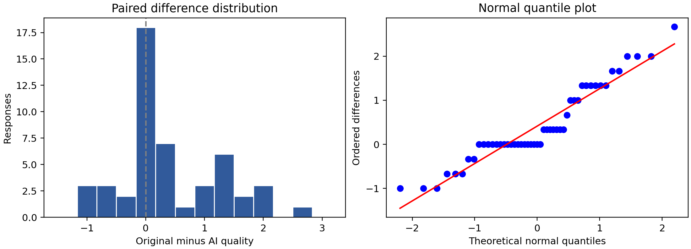
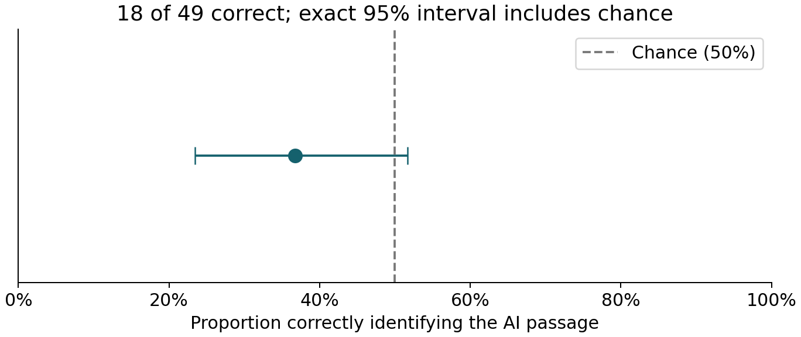
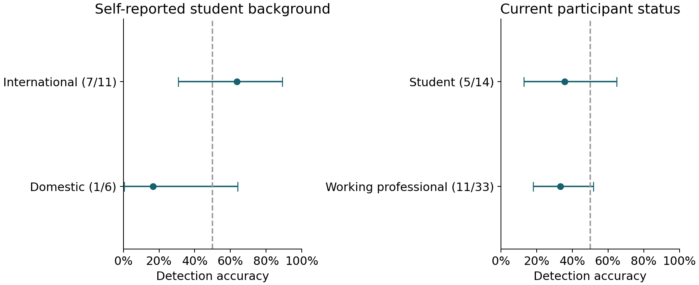

# Perceived writing quality and AI detection in a sleep and memory passage study

Debshree Chowdhury and Jakub Romańczuk

AIPI 510 Term 2 Project

Response snapshot analyzed November 2, 2026

## Abstract

We compared perceived writing quality and AI identification for an original NIH News in Health passage and an AI rewrite about sleep and memory. Participants read both versions, rated clarity, engagement, and overall writing on seven-point scales, answered comprehension checks, and identified the AI passage. The circulated form presented AI first and the original second. Of 54 submissions, five failed both comprehension checks, leaving 49 complete paired responses. Mean composite quality was 5.83 for the original and 5.41 for the AI rewrite. The original-minus-AI difference was 0.415 points, 95% confidence interval [0.167, 0.663], t(48) = 3.369, p = .00149, Cohen dz = 0.481. AI detection accuracy was 36.7% (18/49), with an exact 95% confidence interval of [23.4%, 51.7%]; the exact binomial test did not reject chance performance, p = .0854. Quality findings were stable in legacy-response and nonparametric sensitivity analyses, whereas detection depended on one response's uncertain version. Fixed order, one passage pair, convenience sampling, and questionnaire changes during collection limit generalization. The results support a quality-rating difference for this pair, while leaving detection performance uncertain.

## Background and motivation

Readers encounter AI-assisted prose in educational and scientific communication. Two questions arise: whether a rewrite changes perceived quality and whether readers can recognize its origin. These outcomes need separate measurement. A passage can be judged clear or engaging while its authorship is misclassified; neither judgment alone establishes factual accuracy or learning.

Prior work provides reasons to avoid assuming reliable human detection. Jakesch, Hancock, and Naaman (2023) found that judgments of AI-generated self-presentations relied on imperfect linguistic heuristics. Gao et al. (2023) examined scientific abstracts using blinded reviewers and found both missed generated texts and false accusations against original texts. Their tasks and materials differ from this study, so their detection rates are not directly comparable with a forced choice between two closely related passages.

We used an excerpt from NIH News in Health's April 2013 article Sleep On It and an AI rewrite of the same content (National Institutes of Health, 2013). Keeping the topic and principal information similar supports a focused comparison of prose. This study evaluates perceived writing and source identification; it does not test the underlying sleep science or memory performance.

## Null and alternative hypotheses

### H1: Perceived quality

H0: the population mean original-minus-AI composite quality difference equals zero. H1: the difference is nonzero. The test is two-sided.

### H2: Detection against chance

H0: the probability of correctly identifying the AI passage is .50. H2: that probability differs from .50. This is a two-sided question; the data do not justify choosing a one-sided direction after inspection. It is separate from H1, the quality comparison.

### H3: Detection by student background

For this draft, H0: detection correctness is independent of self-reported international versus domestic student background (population odds ratio = 1). H3: correctness differs between these backgrounds (odds ratio ≠ 1). The original instrument included this grouping question, but no numbered H3 was recorded in the existing plan. This operational definition is provisional pending team confirmation and is a retrospective exploratory analysis, not a new confirmatory claim. Respondents answering Not applicable do not enter this comparison. Background labels are self-reports, not verified citizenship or English proficiency.

### Testing policy

H1 and H2 retain the originally proposed nominal .05 threshold, with a retrospective two-test Bonferroni sensitivity threshold of .025. H3, the participant-status comparison and confidence analyses are exploratory; their p-values are descriptive and unadjusted, not additional confirmatory discoveries. If the team elects to treat all three hypotheses as one confirmatory family in a future study, it should prospectively specify that policy and plan sample size at .05/3. All displayed 95% intervals are marginal, not simultaneous familywise intervals.

## Description of experimental design

This was a within-person paired comparison. The independent variable was passage version: original or AI rewrite. The original was the comparison condition. Dependent variables were clarity, engagement, and overall writing ratings, each from 1 (Not at all) to 7 (Extremely); their mean formed the quality composite. Detection correctness was coded 1 or 0, and confidence ranged from 1 to 5. Participant status and student background described the sample. Optional names were collected separately from the analytic variables.

The form introduced two short science-news passages without announcing AI authorship. Each passage page contained the three ratings and the same comprehension question about the approximately 90-minute sleep cycle. A later page disclosed that one text had been rewritten and requested a forced choice, confidence, and an optional explanation. The answer key, source, rationale for initial nondisclosure, and study contacts appeared after submission. Response editing was disabled.

The circulated form presented AI as Passage 1 and the original as Passage 2. No evidence supports randomized order or balanced allocation in these responses. Consequently, version and position are confounded. Both passages used the same plain-text presentation without separate source branding, but textual NIH references and the shared scientific quotation remained. The rewrite's model, model version, and complete original generation prompt were not preserved in the analyzed export, limiting stimulus reproducibility.

Participation was voluntary through a shared online link, yielding a convenience sample. Eligibility changed from graduate students to students, working professionals, and others aged at least 18. The adult restriction was an instruction; the export contains no recorded age verification. One retained record still has the older affirmative status answer. The report evaluates the downloaded snapshot rather than asserting that collection had closed.

For detection, each person contributed one forced-choice outcome and one confidence response. The paired structure applies to passage ratings, not two independent detection observations. Background and employment/student status were observed characteristics rather than randomized treatments. Group comparisons therefore describe associations and cannot establish a causal effect of background. The presentation and report use the same November 2 snapshot; collection was not stopped by this analysis.

## Power analysis

### H1: Paired quality planning

Power calculations were prepared after collection began. They are planning sensitivities under assumed effects, not prospective justification, observed power, or evidence of preregistration. The initial n = 30 scenario refers to complete pairs. We used Python 3.10 and SciPy 1.15.3. The paired-t calculation uses the noncentral t distribution: the noncentrality is the assumed standardized paired difference multiplied by the square root of the number of complete pairs, with n minus one degrees of freedom. Cohen dz uses the standard deviation of within-person differences, not the pooled standard deviation of the two passages.

| Assumed absolute dz | Pairs for 80% power at .05 | Power with 30 pairs at .05 | Pairs for 80% power at .025 |
|---|---:|---:|---:|
| 0.30 | 90 | 35.5% | 109 |
| 0.50 | 34 | 75.4% | 41 |
| 0.80 | 15 | 98.8% | 18 |

No attrition allowance was specified prospectively. For illustration, 34 usable pairs with a 10% allowance would require 38 recruits, calculated by dividing 34 by .90 and rounding up. This is a planning example, not a claim about the actual recruitment target. The report does not compute power from the observed effect.

### H2: Detection planning

All power calculations were made after collection began and are illustrative planning sensitivities, not prospective justification or observed power. Python 3.10, NumPy 2.2.6 and SciPy 1.15.3 were used. For H2, scripts/report_power.py sums exact binomial alternative probabilities in the two-sided rejection region of a test against .50. Independent, identically distributed participant choices are assumed. Target power is .80; complete cases, rather than recruits, determine n.

| Assumed true accuracy | First n with 80% power at .05 | Power at n = 30, .05 | First n with 80% power at .025 |
|---|---:|---:|---:|
| .60 | 199 | 17.7% | 240 |
| .70 | 49 | 58.9% | 58 |
| .80 | 20 | 93.9% | 24 |

These rates are assumed alternatives, not estimates used to calculate post hoc observed power. Exact rejection regions change discretely: the first qualifying n does not imply that every larger n attains the target. The .025 column corresponds to the retrospective H1/H2 sensitivity policy.

### H3: Between-group detection planning

scripts/group_power.py enumerates independent binomial counts for two equally sized groups and sums their joint probabilities whenever the two-sided probability-ordered Fisher exact p-value is at most .05. Conditional hypergeometric probabilities define the Fisher rejection region; the alternative counts are sampled from assumed group-specific binomial rates. This calculation uses actual Fisher rejection rules rather than a large-sample chi-square approximation.

| Assumed accuracies | Power: 15 per group | Power: 30 per group | Power: 50 per group | Power: 100 per group |
|---|---:|---:|---:|---:|
| .40 vs .60 | 9.5% | 25.7% | 46.2% | 78.7% |
| .30 vs .60 | 22.7% | 56.1% | 82.9% | 98.9% |
| .30 vs .70 | 43.4% | 83.8% | 97.9% | >99.9% |

For an assumed 30-percentage-point gap, 50 complete respondents in each group reach .80 power in this scenario table. This is an example for a future study, not a retrospective recruitment target. The present background groups (11 and 6 under the broad self-report definition) are much smaller and unbalanced. Balanced future recruitment, an attrition allowance, and any multiplicity adjustment should be specified before recruitment. Power planning cannot correct fixed-order confounding or convenience sampling.

## Data collection and cleaning procedures

The CSV contained 54 submissions dated October 31 to November 2, 2026 in the export's timestamp labels. All 54 affirmed consent. Status was Working professional for 36, Student for 15, Other for two, and the legacy Yes for one. Student-background responses were international for 11, domestic for eight, and not applicable for 35. The mismatch between 19 student-background responses and 15 Student classifications may reflect overlapping work/study roles or interpretation differences; it was not an automatic exclusion. Thirty-five names and 21 optional explanations were supplied.

We preserved the downloaded CSV unchanged in local restricted storage and recorded its SHA-256 checksum in the aggregate results. No names or participant explanations are included in the repository outputs. Because both passage blocks use identical question labels, the report script checks the entire export header sequence and maps passage-position columns explicitly. This avoids confusing repeated column names. Ratings, comprehension responses, confidence, consent, and detection were complete. No missing values were imputed.

The proposed exclusion rule removes a respondent only if both comprehension checks are wrong. Six missed the first check and six missed the second; five missed both. Five were excluded, leaving 49 for both primary analyses. Forty-seven passed both checks and two passed one. No timing exclusion was applied because Google Forms did not collect passage-page times. No verified pilot or duplicate-person labels were available, so no such records were removed. Three repeated answer patterns were observed in the full sample; matching ratings do not establish repeated participation.

The primary mapping assumes the current AI-first version for all retained responses. The legacy record's version cannot be verified from the CSV alone. We therefore report analyses omitting it and reversing its version mapping, rather than selecting a treatment based on statistical significance. Names were dropped from analysis, and any request to identify a submitted response would require a separately protected record. Questionnaire revisions and the lack of a verified prospective registration are documented as limitations.

## Statistical analysis

### H1: Quality analysis

For each participant and version, quality was the arithmetic mean of all three ratings. We calculated the original-minus-AI paired difference, its standard deviation, a two-sided paired t-test, a t-based 95% confidence interval, and Cohen dz. Reliability was summarized using Cronbach alpha separately for the two three-item scales on the 49 retained pairs. A two-level paired comparison needs no post hoc pairwise test.

We examined the distribution of paired differences with a histogram, a quantile plot, and Shapiro-Wilk. Independence depends on recruitment and duplicate review and cannot be established by this test. Differences deviated from normality, W = .917, p = .00208. The bounded scales and 18 tied composites warranted an exploratory Wilcoxon signed-rank sensitivity analysis. Mathematical ties were preserved by rounding differences to ten decimal places; its p-value uses a normal approximation with zeros omitted. This test has different assumptions and does not directly test the identical population-mean hypothesis.

Figure 1. Diagnostic views of the 49 original-minus-AI composite differences. Ties and bounded responses produce departures from the normal reference pattern.

### Quality results

| Outcome | AI mean | Original mean | Original minus AI |
|---|---:|---:|---:|
| Clarity | 5.755 | 6.082 | 0.327 |
| Engagement | 5.163 | 5.653 | 0.490 |
| Overall writing | 5.327 | 5.755 | 0.429 |
| Composite quality | 5.415 | 5.830 | 0.415 |

Composite standard deviations were 1.127 for AI and 0.869 for the original. The standard deviation of paired differences was 0.862. The paired test gave t(48) = 3.369, p = .00149, with 95% confidence interval [0.167, 0.663] for the original advantage and dz = 0.481. Original quality was higher for 23 participants, AI quality was higher for eight, and 18 tied. Alpha was .865 for AI and .875 for the original. These estimates indicate internal consistency in this sample, not proof of construct validity.

The exploratory Wilcoxon sensitivity yielded W = 94.0, p = .00242. Omitting the legacy record gave a mean original advantage of 0.424, 95% confidence interval [0.171, 0.676], t(47) = 3.377, p = .00148, and dz = 0.487. Reversing that record's version labels did not change the composite comparison because its two composite scores were equal. Thus, the rating direction and inference are stable under the examined version sensitivities.

### Regression feasibility

AI-use and English reading proficiency were absent from the export, so the originally proposed regression cannot be fitted. They must not be inferred from student background or replaced with invented covariates. The item means above are descriptive; no item-level significance claim is made here.

### H2: Detection methods and results

One forced choice per retained respondent was coded correct under the current AI-first mapping. The proposed chi-square goodness-of-fit test compares correct/incorrect counts with n/2 in each cell; both expected counts are 24.5. We also use the two-sided exact binomial test, its Clopper-Pearson 95% interval, and Cohen w = sqrt(chi-square/n). These tests assume independent participant responses. They test detection against .50 rather than compare passage ratings. There is no pairwise post hoc test for this binary outcome.

Eighteen of 49 respondents correctly selected Passage 1 under the current mapping, while 31 selected Passage 2. Accuracy was 36.7%, exact 95% confidence interval [23.4%, 51.7%]. The exact binomial p-value was .0854. The chi-square test gave chi-square(1) = 3.449, p = .0633, with Cohen w = 0.265. Neither test rejected the chance null at .05.

| Version sensitivity | n | Correct | Exact detection p | Chi-square p |
|---|---:|---:|---:|---:|
| Current mapping | 49 | 18 | .0854 | .0633 |
| Omit legacy response | 48 | 17 | .0595 | .0433 |
| Legacy response original first | 49 | 17 | .0444 | .0321 |

Detection is sensitive to the legacy record and test choice. None of these detection p-values meets .025. The unfiltered exact p-value of .0402 from 54 submissions is not the result after the planned comprehension exclusion. It would be misleading to report that unfiltered finding as the cleaned analysis.

Figure 2. AI-identification accuracy and exact 95% interval from the retained snapshot. The dashed line is chance; the interval includes it.

### H3: Student-background comparison

The broad comparison uses the background question as answered, regardless of a respondent’s separate current-status answer. Eleven retained respondents selected international and six domestic; 32 selected Not applicable. Because some cells are sparse, we use a two-sided Fisher exact test, not a large-sample chi-square independence test. The table columns are correct and incorrect. We report the conditional odds ratio for the first group relative to the second, with exact conditional 95% limits, and each accuracy with an exact binomial interval. These are associations in a convenience sample. H3 is retrospective and its label awaits team confirmation.

| Background | Correct | Incorrect | Accuracy | Exact 95% CI |
|---|---:|---:|---:|---|
| International | 7 | 4 | 63.6% | 30.8%–89.1% |
| Domestic | 1 | 5 | 16.7% | 0.4%–64.1% |

Fisher p = .1312; conditional odds ratio = 7.63, exact 95% CI [0.56, 471.48]. The descriptive risk difference is 47.0 percentage points. The very wide interval includes odds ratio 1, so this is not reliable evidence of a background difference. Background is not a measured language-proficiency scale.

A stricter sensitivity includes only respondents who also selected Student as their current status: 4/8 international and 1/5 domestic, Fisher p = .5649, conditional odds ratio = 3.60, 95% CI [0.21, 245.34]. One of the 14 students answered Not applicable. The broad background comparison includes four respondents outside this strict student subset; this illustrates the ambiguity of overlapping work/study roles and the changed instrument. Omitting the legacy response yields Fisher p = .1451; reversing its detection mapping yields p = .3043. Neither resolves the small-sample uncertainty.

### Other group comparison

The separate Student versus Working professional comparison gives 5/14 (35.7%) versus 11/33 (33.3%) correct. The Other response and legacy Yes response are omitted from this specific comparison, not from the full study. Fisher p = 1.000; conditional odds ratio = 1.11, 95% CI [0.23, 4.85]; the descriptive difference is 2.4 percentage points. This explicitly defined two-group comparison does not collapse Other into an arbitrary category or apply Fisher’s 2-by-2 procedure to a three-category table.

Figure 3. Group accuracies with exact marginal 95% intervals. Background and current-status panels use overlapping respondents and different denominators; they are not four independent groups.

### Confidence

Confidence is ordinal from 1 (Just guessing) to 5 (Extremely confident), not a probability estimate. Mean confidence was 3.16, with a median of 3. Correct respondents (n = 18) averaged 3.06, and incorrect respondents (n = 31) averaged 3.23; both medians were 3. A two-sided Mann-Whitney comparison, using the tie-corrected asymptotic distribution and continuity correction, gave U = 253.0, p = .5487. The rank-biserial effect for correct minus incorrect confidence was -.093. This test compares confidence distributions and is not presented as a direct test of mean equality.

Spearman rho between confidence and correctness was -.0883 (asymptotic p = .5465). Because the sample is small and heavily tied, we also permuted correctness labels 99,999 times with seed 510; the two-sided absolute-rho p-value, with a plus-one correction, was .5378. This permutation assumes exchangeability under the null. The two summaries describe the same underlying relationship and are not independent confirmations. Omitting or reversing the legacy response left the confidence conclusion unchanged (Mann-Whitney p = .5842/.6086; permutation p = .5975/.6216). No probability-calibration claim can be made from this verbal five-point scale.

Optional explanations were not formally coded or treated as validated authorship cues. All added group and confidence tests are exploratory with unadjusted p-values. Failure to reject does not establish equivalence, particularly for the small background groups. The aggregate evidence and chart inputs are in results/debshree_statistics.json; no names or free text are published.

## Interpretation of results

### Quality findings

The original passage received higher quality ratings in this sample, with a mean advantage of approximately four-tenths of a scale point and a standardized paired difference of 0.48. Engagement showed the largest descriptive component gap. Both passages still received relatively high ratings. Statistical significance does not establish that every reader preferred the original, nor that this magnitude would be important in every application.

### Detection, group and confidence findings

Respondents more frequently identified the original as AI-written under the current mapping. Yet the cleaned exact interval includes .50, and the legacy-version sensitivities change nominal detection significance. The appropriate conclusion is uncertain detection performance for this pair, not demonstrated equivalence to chance or universal inability to detect AI. The lower unfiltered p-value must not replace the comprehension-filtered result.

The international-background group had higher descriptive accuracy, but the small cells, wide conditional odds-ratio interval, and sensitivity to group definition prevent a firm population claim. The employment/student comparison likewise supplies no clear evidence of different detection rates. Neither analysis identifies a causal effect or measures English proficiency. A difference between one significant and one nonsignificant within-group test would not establish a between-group difference; the direct Fisher comparisons answer that question here.

Confidence did not meaningfully separate correct and incorrect choices in this snapshot. Respondents with greater confidence were not reliably more accurate, but the uncertainty does not prove the absence of an association. These results support keeping perceived writing quality, authorship judgments and confidence conceptually separate. All conclusions concern this particular passage pair under fixed presentation order.

## Limitations

### Ratings and data

The three bounded rating items are subjective; internal consistency is not proof of construct validity. Paired differences depart from normality and contain many ties, so the nonparametric sensitivity is relevant but does not test exactly the same mean hypothesis. Duplicate-person, pilot and test-response status could not be verified; repeated answer patterns were retained. Age, passage-page timing, AI-use and English proficiency were not collected in the export, preventing the proposed timing exclusion and covariate regression. Optional names made some responses identifiable, and early anonymous and later identified records followed different notices.

### Stimulus, design and sampling

Fixed AI-first order confounds version with presentation position and permits carryover, familiarity and contrast effects. Both passages repeat the same information, so the second exposure may benefit comprehension or familiarity irrespective of authorship. One science topic and one rewrite do not represent human or AI prose generally. The texts share a direct scientific quotation, and the model, version and full generation prompt were not preserved in the export. Plain formatting reduced external source cues but did not remove textual NIH references.

Recruitment was voluntary through a shared link, with a convenience sample dominated by working professionals. The sample cannot estimate population-wide detection performance. Eligibility and the name question changed during launch, and one record lacks verified passage assignment. Student-background and current-status answers did not align exactly; broad and strict subgroup definitions lead to different denominators. Groups are small, unbalanced and nonrandomized; their wide intervals preclude strong claims about international/domestic backgrounds or work/student status. Background must not be used as a proxy for citizenship, nationality or language proficiency.

The snapshot does not establish that collection ended. Hypothesis numbering, the added H3 group comparison, power sensitivities and multiplicity handling are retrospective. The draft H3 definition requires team confirmation and cannot be described as preregistered. Instructor or ethics approval for initial nondisclosure is not established by the available records and is not claimed. These limits should remain visible in both the written report and presentation.

## Conclusion and recommendations

In this response snapshot, the original sleep-and-memory passage received higher composite quality ratings than its AI rewrite, and this difference persisted across the examined sensitivities. Cleaned detection accuracy was below .50 numerically but did not provide stable evidence of a difference from chance. These findings concern this fixed-order passage pair and sampled respondents.

A follow-up should randomize passage order, use multiple independently selected passage pairs, preserve model and prompt provenance, and freeze eligibility, exclusions, and the testing policy before recruitment. If reading-time exclusions or order blocking are essential, use a platform that records those features. Keep names separate from analytical data when participation tracking is needed. Verify the legacy response and any known pilot records before the team signs off on the final dataset, and report any resulting changes transparently.

The exploratory background and confidence results remain inconclusive. A future study should predefine the group comparison, recruit enough participants within each group, and distinguish background from reading proficiency.

## References

Gao, C. A., Howard, F. M., Markov, N. S., Dyer, E. C., Ramesh, S., Luo, Y., & Pearson, A. T. (2023). Comparing scientific abstracts generated by ChatGPT to real abstracts with detectors and blinded human reviewers. npj Digital Medicine, 6, 75. https://doi.org/10.1038/s41746-023-00819-6

Jakesch, M., Hancock, J. T., & Naaman, M. (2023). Human heuristics for AI-generated language are flawed. Proceedings of the National Academy of Sciences, 120(11), e2208839120. https://doi.org/10.1073/pnas.2208839120

National Institutes of Health. (2013, April). Sleep On It. NIH News in Health. https://newsinhealth.nih.gov/2013/04/sleep-it

SciPy developers. (n.d.). Statistical functions and distribution documentation for ttest_rel, binomtest, chisquare, shapiro, wilcoxon, nct, binom, fisher_exact, mannwhitneyu, spearmanr, and contingency.odds_ratio. https://docs.scipy.org/doc/scipy/reference/stats.html

SciPy developers. (n.d.). Fisher exact test. https://docs.scipy.org/doc/scipy/reference/generated/scipy.stats.fisher_exact.html

SciPy developers. (n.d.). Mann-Whitney U test. https://docs.scipy.org/doc/scipy/reference/generated/scipy.stats.mannwhitneyu.html

SciPy developers. (n.d.). Spearman rank correlation. https://docs.scipy.org/doc/scipy/reference/generated/scipy.stats.spearmanr.html

## Reproducibility and contribution note

Statistical calculations use Python 3.10, NumPy 2.2.6, and SciPy 1.15.3. The repository includes executable report-evidence and power scripts, aggregate JSON outputs, the expected export headers, and reproduction instructions. Identifiable CSV exports are withheld from GitHub. The report records a November 2 snapshot and does not imply live collection was stopped. AI assistance was used to prepare code and report text; the project members are responsible for reviewing the analysis, references, and final submission.

Owner-folder files are stitched in the course order by make report. Kuba’s files were migrated from the pre-existing draft to preserve content; their presence does not establish that he wrote, reviewed or submitted them. Debshree’s assigned sections and exploratory detection/group/confidence analyses are prepared for review. Shared abstract and conclusion remain joint-review drafts.
